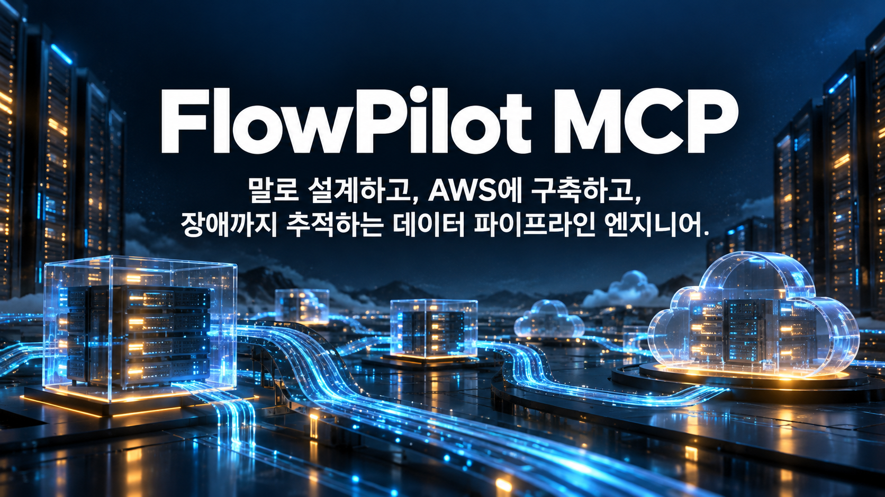

# pmcp — FlowPliot MCP

AI 네이티브 [해커톤 신입인데 만렙입니다](https://apply.vooy.dev/) 본선 최종 제출물

https://youtu.be/wTJm9R8l5Fs <span style="opacity: 0.5;">참고 - 시간의 압박 때문에 시현 영상의 퀄리티는 높은편이 아닙니다.</span>

vooy 에이전트가 사용자 자신의 AWS 계정에서 데이터 파이프라인을 조사·설계·생성·수정·검증·운영할 수 있게 해주는
원격 MCP 서버.

- 접속 주소: ~~`https://mcp.m161awm.kr/mcp`~~ **대회 종료로 닫았습니다.** (Streamable HTTP, Bearer JWT)
- 도구 20개: 조사 5, 계약·설계 5, 변경 3, 검증 1, 운영 5, 작업 조회 1
- 배포 가능한 패턴 4개, 카탈로그에만 있는 패턴 6개. 적합성과 구현 상태를 분리해서 보고한다.
- 계획을 실행하려면 사람이 브라우저에서 승인해야 한다. 승인은 계획의 digest에 묶이고, 대상이 바뀌었는지 확인한다.
- 파이프라인과 감시는 사용자 계정 안에서 돌아간다. 대화가 끝나도 계속 동작한다.

| 문서 | 내용 |
|---|---|
| [docs/01-requirements-and-decisions.md](docs/01-requirements-and-decisions.md) | 요구사항, 설계 결정, awslabs 재사용 근거(커밋 `24c3970`), 범위 변경 |
| [docs/02-mcp-tool-spec.md](docs/02-mcp-tool-spec.md) · [docs/tool-schemas.json](docs/tool-schemas.json) | 도구 명세와 JSON 스키마 |
| [docs/03-adapters-and-support.md](docs/03-adapters-and-support.md) | 어댑터·지원 구성 목록, 지원하지 않는 조합 |
| [docs/04-install-run-permissions.md](docs/04-install-run-permissions.md) | 설치, 실행, 권한 설정 |
| [docs/05-demo-scenario.md](docs/05-demo-scenario.md) | 발표 데모 시나리오 |
| [docs/06-verification-evidence.md](docs/06-verification-evidence.md) | 모의 테스트와 실제 AWS 검증 증거 (구분해서 기록) |

```
src/pmcp/
  mcp_server/   MCP 인터페이스(도구 20개, 출력 모델, 서버 조립)
  auth/         JWT, Cognito 로그인, 계정 연결, 승인 페이지
  services/     조사·계약·설계·계획·작업(워커)·검증·운영
  adapters/     패턴별 어댑터(Athena/Iceberg, Firehose, Lambda→DynamoDB, Glue) + 공통 인터페이스
  catalog/      서비스 정보, 패턴 적합성, 단가, 통합 검증 상태
  aws/          테넌트 세션(AssumeRole+ExternalId), 소유 태그, 마스킹
  store.py      DynamoDB/메모리 상태 저장(CAS, 멱등 키, 잠금)
  vendor/awslabs/  Apache-2.0으로 가져온 코드(LICENSE/NOTICE 포함)
infra/          platform.yaml, ecr.yaml, tenant-onboarding.yaml
scripts/        platform.sh(배포), gen_orders.py(합성 데이터)
tests/          moto와 스텁 기반 모의 테스트
```

```
uv sync && uv run pytest
```
